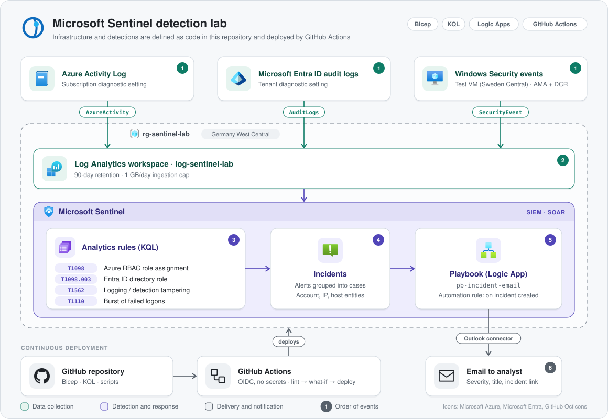
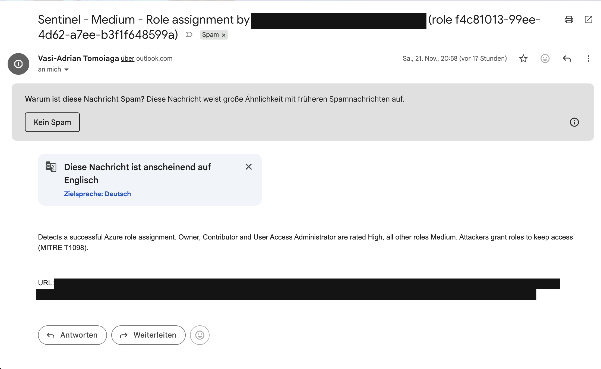
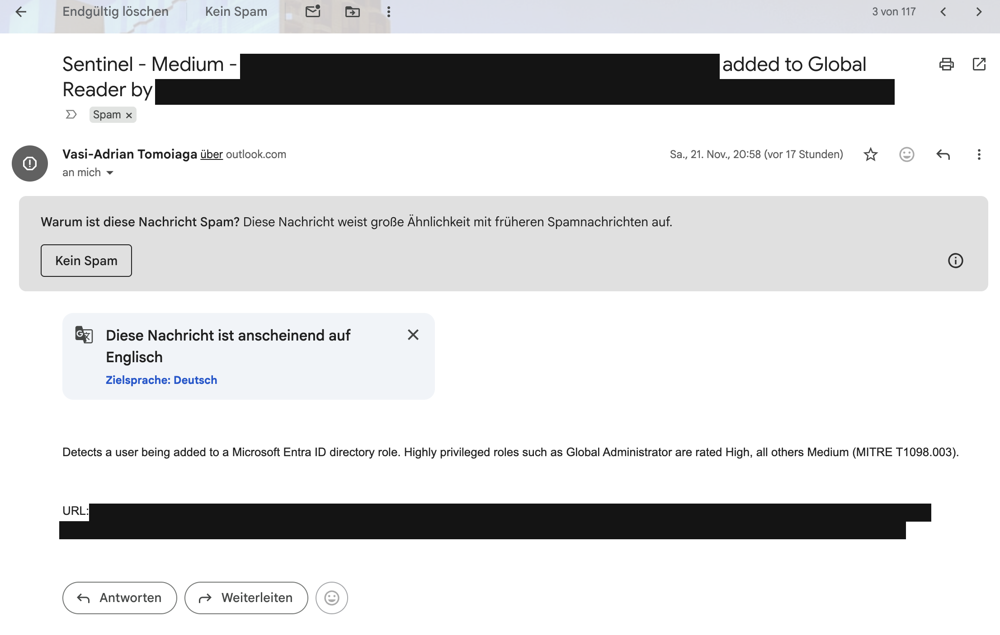

# Microsoft Sentinel Detection Lab

[](https://github.com/Vasitmg/azure-cloud-portfolio/actions/workflows/deploy-sentinel-lab.yml)

A hands-on security operations lab on Microsoft Azure. Everything is deployed as **Infrastructure as Code (Bicep)**, and the detection rules are written in **KQL** and kept in version control.

> **Status:** 🚧 Work in progress. Infrastructure and the first data source are live; more data sources and detections are being added.

## Goals

- Build a working SIEM with Microsoft Sentinel from scratch, without clicking resources together in the portal
- Collect real security telemetry (Azure Activity, Microsoft Entra ID, Windows security events)
- Write and test my own detection rules mapped to MITRE ATT&CK
- Automate the response to incidents with playbooks
- Deploy everything through a CI/CD pipeline (GitHub Actions)

## Architecture



## What is deployed

| Component | Resource | Defined in |
|---|---|---|
| Resource group | `rg-sentinel-lab` | `infra/main.bicep` |
| Log Analytics workspace | `log-sentinel-lab` (90-day retention, 1 GB/day cap) | `infra/modules/sentinel.bicep` |
| Microsoft Sentinel | enabled on the workspace | `infra/modules/sentinel.bicep` |
| Data source: Azure Activity | subscription diagnostic setting `activity-to-sentinel` | `infra/main.bicep` |
| Data source: Windows Security events (optional test VM) | `vm-lab-win01` + Azure Monitor Agent + DCR `dcr-windows-security-events`, no public IP, auto-shutdown | `infra/modules/vm.bicep` |
| Playbook | Logic App `pb-incident-email` + automation rule "Email on every new incident" | `infra/modules/playbook.bicep` |
| Data source: Entra ID audit logs | tenant diagnostic setting `entra-to-sentinel` | `az rest` (tenant scope, see below) |

## Repository structure

```
sentinel-lab/
├── infra/        Bicep: main.bicep + modules (Sentinel, rules, playbook, test VM)
├── detections/   KQL detection rules (loaded into the analytics rules)
├── hunting/      KQL hunting queries
├── scripts/      Report generator and test scripts
├── docs/         Architecture diagram and screenshots
└── README.md
```

## CI/CD

Every push to `main` that touches `infra/` or `detections/` runs [`.github/workflows/deploy-sentinel-lab.yml`](../.github/workflows/deploy-sentinel-lab.yml):

1. **Lint** – `az bicep build`
2. **What-if** – shows the planned changes (pull requests stop here)
3. **Deploy** – `az deployment sub create`

The pipeline signs in with **OpenID Connect (workload identity federation)**: an Entra ID app registration trusts GitHub tokens for this repository only (`main` branch and pull requests). No client secret exists. The app has **Contributor** on the subscription, which can deploy resources but cannot assign roles.

GitHub secrets used by the pipeline:

| Secret | Purpose |
|---|---|
| `AZURE_CLIENT_ID`, `AZURE_TENANT_ID`, `AZURE_SUBSCRIPTION_ID` | OIDC sign-in |
| `NOTIFICATION_EMAIL` | Recipient for incident emails. Without it, the playbook is skipped, so the address never appears in the repo. |

**One-time manual steps** (cannot be automated): the two API connections of the playbook (`azuresentinel-pb-incident-email` with managed identity, `outlook` with an interactive Outlook.com sign-in) and Sentinel's *playbook permissions* on the resource group.

## Deploy it yourself

**Prerequisites:** an Azure subscription, the [Azure CLI](https://learn.microsoft.com/cli/azure/install-azure-cli) and Bicep (`az bicep install`).

```bash
# 1. Sign in
az login

# 2. Register the resource providers (one time per subscription)
az provider register --namespace Microsoft.OperationalInsights
az provider register --namespace Microsoft.OperationsManagement
az provider register --namespace Microsoft.SecurityInsights
az provider register --namespace Microsoft.Insights

# 3. Preview the changes
az deployment sub what-if --location germanywestcentral \
  --template-file infra/main.bicep

# 4. Deploy
az deployment sub create --location germanywestcentral \
  --template-file infra/main.bicep
```

**Entra ID audit logs** (tenant level, needs Global Administrator):

```bash
WS_ID=$(az monitor log-analytics workspace show -g rg-sentinel-lab -n log-sentinel-lab --query id -o tsv)
az rest --method put \
  --url "https://management.azure.com/providers/microsoft.aadiam/diagnosticSettings/entra-to-sentinel?api-version=2017-04-01" \
  --body "{\"properties\":{\"workspaceId\":\"$WS_ID\",\"logs\":[{\"category\":\"AuditLogs\",\"enabled\":true}]}}"
```

**Optional test VM** (Windows Security events; never deployed by the pipeline):

```bash
read -s "VMPASS?VM admin password: "; echo
az deployment sub create --location germanywestcentral \
  --template-file infra/main.bicep \
  --parameters deployVm=true vmAdminPassword="$VMPASS" vmLocation=swedencentral vmSize=Standard_B2s_v2

# create 10 failed logons inside the VM, then run detections/windows-failed-logon-burst.kql
az vm run-command invoke -g rg-sentinel-lab -n vm-lab-win01 \
  --command-id RunPowerShellScript --scripts @scripts/failed-logons.ps1

# remove the VM again (disk and NIC are deleted with it)
az vm delete -g rg-sentinel-lab -n vm-lab-win01 --yes
```

The VM has **no public IP and no inbound ports**. Instead of exposing RDP to the internet as a honeypot, failed logons are generated inside the VM with the Windows `LogonUser` API.

**Tear down** (to stop all costs):

```bash
az group delete --name rg-sentinel-lab
az monitor diagnostic-settings subscription delete --name activity-to-sentinel
```

## Detections

| Rule | Data source | MITRE ATT&CK | File |
|---|---|---|---|
| New Azure RBAC role assignment | AzureActivity | T1098 Account Manipulation | [`role-assignment-created.kql`](detections/role-assignment-created.kql) |
| Security logging or detection tampering | AzureActivity | T1562 Impair Defenses | [`security-logging-tampering.kql`](detections/security-logging-tampering.kql) |
| User added to Entra ID directory role | AuditLogs | T1098.003 Additional Cloud Roles | [`entra-privileged-role-assigned.kql`](detections/entra-privileged-role-assigned.kql) |
| Burst of failed Windows logons | SecurityEvent | T1110 Brute Force | [`windows-failed-logon-burst.kql`](detections/windows-failed-logon-burst.kql) |

## Results

The full chain works end to end: **log → detection → incident → playbook → email**.

| Detection | Incident email (redacted) |
|---|---|
| New Azure RBAC role assignment |  |
| User added to Entra ID directory role |  |

The RBAC rule also caught a real, unplanned event: enabling playbook permissions made Sentinel grant its own service principal the *Microsoft Sentinel Automation Contributor* role. A good reminder that "expected" admin actions still create privileged role assignments worth reviewing.

## Tuning backlog

- [x] Translate role GUIDs into role names in the alert title (e.g. `f4c81013-…` → Microsoft Sentinel Automation Contributor)
- [x] Deduplicate role-assignment alerts per `CorrelationId` so one assignment creates one alert
- [x] Rate *Role Based Access Control Administrator* as High (it can grant access)
- [ ] Allow-list known automation identities to reduce noise

## Cost control

- Daily ingestion cap of 1 GB on the workspace
- Budget with email alerts at 50 %, 80 % and 100 % on the subscription
- The whole lab can be deleted and rebuilt from code in a few minutes

## Lessons learned

- **Resource providers must be registered first.** On a new subscription, enabling Sentinel failed with `MissingSubscriptionRegistration` for `Microsoft.OperationsManagement`. Registering the providers once fixed it, so the step is now part of the deploy instructions.
- **Activity Log events come in pairs.** A role assignment is logged as a `Start` event and a `Success` event with the same `CorrelationId`. Only the `Start` event contains the request body with the role and the principal. My first detection read the `Success` event only, so the role was always empty and every assignment was rated "Medium" (an Owner assignment would have been missed as high severity). Joining both events on `CorrelationId` fixed it. Lesson: always inspect the raw event (`bag_keys(Properties_d)`) before writing parsing logic.

- **New role assignments need time to propagate.** The first pipeline run failed while creating the Sentinel analytics rules, minutes after the app got its Contributor role. A re-run a few minutes later succeeded. Lesson: allow for RBAC propagation (up to ~10 minutes) after granting a new identity access, before blaming the template.

- **Trial subscriptions have limited VM capacity.** Every VM size failed in Germany West Central with `SkuNotAvailable`. The fix was to make the VM region a parameter (`vmLocation`): the VM runs in Sweden Central, while the workspace and the data collection rule stay in Germany West Central.

## Roadmap

- [x] Log Analytics workspace + Microsoft Sentinel via Bicep
- [x] Azure Activity data source
- [x] Microsoft Entra ID audit logs
- [x] Windows VM with security events (Azure Monitor Agent + data collection rule)
- [x] 4 custom detection rules deployed as code
- [x] Playbook: email notification on every new incident (Logic App + automation rule)
- [x] Playbook and automation rule deployed from the repo (recipient comes from a GitHub secret)
- [ ] Playbook: disable user on high-severity incident
- [x] GitHub Actions pipeline with OIDC: lint → what-if → deploy
- [x] Architecture diagram and screenshots in `docs/`