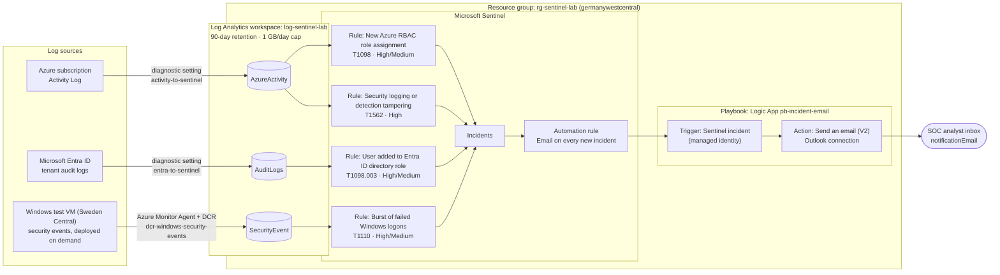
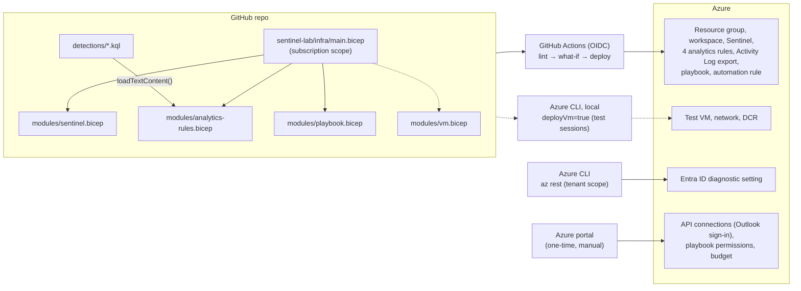

# Architecture

Current state of the Microsoft Sentinel Detection Lab. The overview diagram is [`architecture.svg`](architecture.svg), generated by [`scripts/build_architecture.py`](../scripts/build_architecture.py).

## Data flow: from activity to incident to email

**How it works**

1. The subscription **Activity Log** and the Entra ID **audit logs** are forwarded to the workspace by diagnostic settings, landing in the `AzureActivity` and `AuditLogs` tables. The optional test VM sends Windows Security events (4624, 4625, 4672, 4720, 4732) through the Azure Monitor Agent and a data collection rule into `SecurityEvent`.
2. Four **scheduled analytics rules** run every hour over the last hour of data. Each rule's KQL lives once in [`detections/`](../detections/) and is loaded into Bicep with `loadTextContent()`.
3. Every match becomes an alert and an **incident**. Three rules set severity per alert from a `Severity` column (privileged roles or 20+ failed logons = High, otherwise Medium).
4. The **automation rule** runs the **`pb-incident-email`** playbook on every new incident. The playbook authenticates to Sentinel with its system-assigned managed identity and sends the incident title, severity, description and link through Outlook.

## Deployment: how the code becomes resources

| What | Deployed by | Why |
|---|---|---|
| Resource group, workspace, Sentinel, 4 analytics rules, Activity Log export, playbook, automation rule | GitHub Actions → `infra/main.bicep` | Every push to `main` that touches `infra/` or `detections/` |
| Test VM, network, data collection rule | Local `az deployment sub create` with `deployVm=true` | Only for test sessions; the pipeline never creates it, and the password is never stored |
| Entra ID diagnostic setting | `az rest` | Tenant-scope resource that needs a directory role |
| API connections, playbook permissions, budget | Portal, one time | The Outlook connection needs an interactive sign-in; playbook permissions are a role assignment the pipeline (Contributor) cannot make |

## Cost and security controls

- **Ingestion cap:** 1 GB/day on the workspace, plus a subscription budget with alerts at 50 %, 80 % and 100 %.
- **No secrets in code:** the pipeline signs in with OIDC, the playbook uses a managed identity for Sentinel, the recipient address comes from a GitHub secret, and the VM password is typed at deploy time.
- **No exposed VM:** the test VM has no public IP and no inbound rules, and shuts down automatically at 22:00.
- **Disposable:** `az group delete --name rg-sentinel-lab` plus removing the two diagnostic settings tears the whole lab down; it can be rebuilt from code in minutes.
