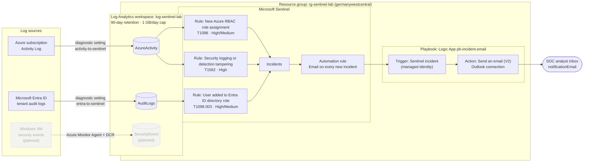
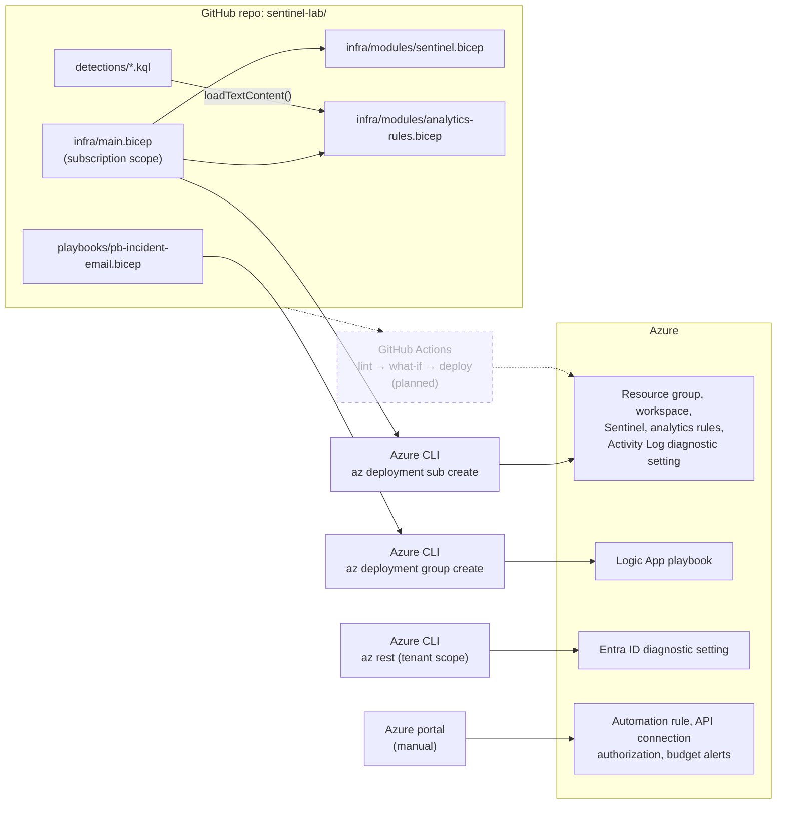

# Architecture

Current state of the Microsoft Sentinel Detection Lab. Solid lines are live today; dashed boxes are on the roadmap.

## Data flow: from activity to incident to email

**How it works**

1. The subscription **Activity Log** and the Entra ID **audit logs** are forwarded to the workspace by diagnostic settings, landing in the `AzureActivity` and `AuditLogs` tables.
2. Three **scheduled analytics rules** run every hour over the last hour of data. Each rule's KQL lives once in [`detections/`](../detections/) and is loaded into Bicep with `loadTextContent()`.
3. Every match becomes an alert and an **incident**. The RBAC and Entra rules set severity per alert from a `Severity` column (High for privileged roles, Medium otherwise).
4. The **automation rule** runs the **`pb-incident-email`** playbook on every new incident. The playbook authenticates to Sentinel with its system-assigned managed identity and sends the incident title, severity, description and link through Outlook.

## Deployment: how the code becomes resources

| What | Deployed by | Why not in Bicep (yet) |
|---|---|---|
| Resource group, workspace, Sentinel, 3 analytics rules, Activity Log export | `infra/main.bicep` | n/a |
| Logic App `pb-incident-email` | `playbooks/pb-incident-email.bicep` (resource-group scope) | n/a |
| Entra ID diagnostic setting | `az rest` | Tenant-scope resource that needs Global Administrator |
| Automation rule, Outlook connection sign-in, budget | Portal | The Outlook API connection needs an interactive OAuth consent |

## Cost and security controls

- **Ingestion cap:** 1 GB/day on the workspace, plus a subscription budget with alerts at 50 %, 80 % and 100 %.
- **No secrets in code:** the playbook uses a managed identity for Sentinel, and the recipient address and subscription ID are parameters, not hard-coded values.
- **Disposable:** `az group delete --name rg-sentinel-lab` plus removing the two diagnostic settings tears the whole lab down; it can be rebuilt from code in minutes.
